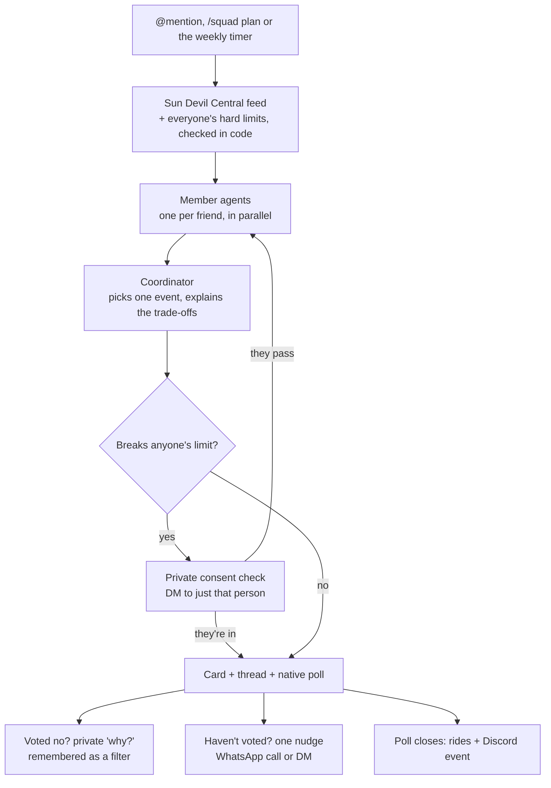

<div align="center">



<br>

**Your group chat says "we should hang out" every week. Squad Mode picks the night, the event and the ride, so you actually go.**

<a href="#try-it"></a>
<a href="#how-it-works"></a>
<a href="#what-each-agent-shares-vs-keeps-private"></a>
<a href="#for-builders"></a>

[See it](#see-it) · [Try it](#try-it) · [How it works](#how-it-works) · [Run your own](#run-your-own)

</div>

## The moment

Someone drops "we should actually do something this weekend 😩". Six people react with 💯. Nobody picks a thing.
Friday comes, everyone's on their phone in their own dorm. Same thing next week.

The hard part was never finding an event. It's the group stuff: who's free, who's broke this week, who can't do
late nights, who has a car. Nobody wants to say "I can't afford that" out loud in the group chat.

Squad Mode gives every friend their own little agent that knows those things and keeps them private. The agents work
it out, the bot posts one plan, and you vote. Let's get the whole squad some grass to touch. 🌵

## See it

<table>
<tr>
<td width="46%" align="center">

</td>
<td>

**1. Ask like a human.**
`@Side Quests Squad something chill Friday under $15, no clubs`

**2. Every friend's agent weighs in.**
Each one knows only its own person. They score this week's real ASU events and say one friendly line each, in a
thread.

**3. It asks before it bends your rules.**
If the best pick breaks your limit, you get a private DM first: "Heads up: it runs past 10pm. Still up for it?"

**4. One card, one native poll.**
I'm in ✅ · Maybe 🤔 · Can't make it ❌. Said no? A private "mind sharing why?", and it remembers for next time.

**5. Rides and a calendar invite.**
When the poll closes: who drives whom, a light rail or Orbit tip for the rest, and a real Discord event. Forgot to
vote? One friendly nudge.

</td>
</tr>
</table>

## Try it

1. **[Add to Discord](https://discord.com/oauth2/authorize?client_id=1563800334231670835)** and pick your server.
2. In any channel: `/squad join`. Two short forms: what you're into, when you're usually free, budget, hard no's,
   car seats, then (optional) a WhatsApp number and quiet hours. There's an optional "Connect Google Calendar" button
   too.
3. Alone right now? `/squad demo` brings in four demo friends (Maya, Jordan, Priya and Leo), each with their own
   agent, schedule and opinions.
4. `/squad plan`, or just @-mention the bot with a vibe:

```text
@Side Quests Squad something chill Friday under $15, no clubs
```

More: `/squad weekly` sets the day and hour of the automatic weekly plan (Wednesday 6 pm until you change it),
right-click any message → **Apps → Plan this** turns "we should go bowling" into a plan, and `/squad leave` forgets
you.

## How it works



| | Step | What happens |
|:-:|---|---|
| 🗺️ | **The feed** | Real in-person events from ASU's Sun Devil Central for the next 7 days (the same reader as [Side Quests](https://github.com/ashwanthbalakrishnan5/cubbie-side-quest), cached so it's fast). |
| 🧮 | **The rules** | Plain code drops what doesn't fit the ask and ranks the rest by how few people's limits each one breaks. Top 6 go to the agents. |
| 🤖 | **The agents** | One Claude call per friend, in parallel. Each scores the events 0–10 and writes one line the group can see. |
| 🎯 | **The pick** | The coordinator chooses and writes the why. It can only pick from the list; anything else falls back to a code pick. |
| 🗳️ | **The vote** | A Components V2 card, a native Discord poll (1 hour) and a thread where each friend's agent says its line. |
| 🧠 | **The memory** | "Why no?" answers become filters like "no events after 9pm on Fridays" that shape next week's pick. |
| 🚗 | **The ride** | Drivers with free seats take riders; anyone left over gets a light rail, Orbit or shuttle tip based on the venue. |
| 📅 | **The event** | A Discord scheduled event with the real time and place, so Discord reminds everyone. |

## What each agent shares vs keeps private

| Your agent shares | Your agent keeps private |
|---|---|
| A 0–10 score for each candidate event (coordinator only) | Your budget number |
| One friendly line, posted in the thread ("I'd love the open mic 🎤") | Your calendar and free times (checked in code; never sent to any model) |
| Which *kind* of limit a plan breaks ("a budget limit", "a schedule clash") | Your hard no's and the detail ("it's $20 and your cap is $15" only ever goes to you) |
| | Filters it learned from you |
| | Your "why no?" reasons |

The coordinator sees whose limit is which kind so it can weigh them, but never the detail, and it's told never to
name anyone in public. Trade-offs on the card read like "someone has a budget limit".

## When it asks you first

When the best plan breaks someone's limit (busy then, over budget, a hard no, a late night, something they told the
bot before), **code, not the model, decides who must confirm.** Everyone whose limit is broken gets one private DM
with the real reason and two buttons: "Sure, count me in" or "Pass on this one".

- Nobody answers within 10 minutes, or DMs are closed? That counts as a pass.
- Anyone passes? The bot quietly tries the next best event, up to 3 times, then posts "No side quest this week" with
  the closest call. A real person's answer is never posted.
- In the demo, the four personas answer automatically: yes, unless the plan hits their late-night limit or a hard no.
  Their agents post "checked with Leo privately: all good" in the thread so you can watch the round happen.

## Why students need this

- **Group chats are where plans go to die.** Everyone's waiting for someone else to pick. The bot just picks.
- **Saying no out loud is awkward.** "I'm broke" or "I can't do late nights" stays between you and your agent.
- **Your campus already has the fun stuff.** Free food, open mics, game nights, all on Sun Devil Central. Nobody
  scrolls a whole events calendar in a group chat; one card with a poll gets read.
- **Getting there is half the plan.** Who has a car and who's taking the light rail gets sorted for you.
- **Friendships happen on repeat.** A weekly plan with the same people beats one big night that never happens.

## Run your own

You need [uv](https://docs.astral.sh/uv/), Python 3.12+ and a Discord server you can add bots to.

**1. Discord app.** In the [Developer Portal](https://discord.com/developers/applications): New Application → Bot →
turn on **Message Content Intent** → copy the token. Invite it with the `bot` and `applications.commands` scopes and
these permissions: View Channels, Send Messages,
Send Messages in Threads, Embed Links, Read Message History, Create Polls, Add Reactions, Create Public Threads,
Manage Webhooks, Create Events.

**2. Keys.**

```bash
cp .env.example .env
```

| Key | What it's for |
|---|---|
| `DISCORD_TOKEN` | the bot token (required) |
| `ANTHROPIC_API_KEY` | the agents and coordinator (required) |
| `GEMINI_API_KEY` | the voice nudge (required at start-up, even before WhatsApp is paired) |
| `COMPOSIO_API_KEY` | a Composio **project** key; leave empty to turn calendars off |
| `COMPOSIO_CALENDAR_AUTH_CONFIG` | your Composio Google Calendar auth config id |
| `PUBLIC_URL` | where Composio sends people back after calendar sign-in (`/calendar/done`) |

Without a calendar, the free times people tick in `/squad join` are used instead.

**3. Run.**

```bash
uv sync
uv run python -m squad --check   # checks .env and imports everything, no network; prints ok
uv run python -m squad           # the bot, plus a small web server on :8090 (site, /health, /calendar/done)
```

For demos, `DEMO_FAST=1 uv run python -m squad` makes the demo friends vote within 20 seconds, the private check
wait 1 minute instead of 10, and the nudge come after 1 minute instead of 30.

> [!WARNING]
> Run one copy of the bot per token. Two processes with the same token both answer every command.

## Voice nudge (WhatsApp)

When someone hasn't voted after 30 minutes, the bot nudges them once (never during their quiet hours). If they opted
in and gave a number, that nudge can be a short phone call: a friendly voice gives the plan in one sentence, asks
"you in?", and records yes, maybe or no. The thread gets "📞 Sam picked up and said yes"; any reason stays private. Demo friends are never called.

How: [`wa-voice/`](wa-voice/README.md) is a small Rust sidecar on
[whatsapp-rust](https://github.com/oxidezap/whatsapp-rust) that places the WhatsApp call, and
`squad/voice/bridge.py` streams the audio to Gemini Live (`gemini-3.8-live`). Calls end within 90 seconds.

**Honest status:** it's built and tested, but it needs a WhatsApp number paired by QR code, and that hasn't happened
yet. Until it's paired, nudges fall back to a Discord DM (or a channel @-mention if DMs are closed). whatsapp-rust is
an unofficial client, so the number it runs on may get banned. Use a spare.

```bash
cd wa-voice && cargo run --release     # first start writes the pairing QR to data/wa-qr.txt
qrencode -t ansiutf8 < data/wa-qr.txt  # scan from WhatsApp → Linked devices
```

## Privacy

- **Busy blocks only.** Calendars go through Composio and the bot only asks for free/busy times, never event titles.
- **No chat logs.** The bot only acts on messages that @-mention it (or that you pick with Plan this), and never
  stores them.
- **`/squad leave` forgets you.** It deletes your profile (tastes, limits, number, learned filters), takes you out of
  every squad and disconnects your calendar. Votes on past plans stay on those plans.
- **Models see only what they need.** Each member agent sees one person's profile. Voice calls get the plan, your
  Discord display name and who's going.
- **Heads up:** Composio's Google consent screen asks for more calendar access than the bot uses. The code only calls
  the free/busy lookup.

## For builders

```bash
uv run pytest                               # 131 tests
uv run ruff check . && uv run ruff format .
cd wa-voice && cargo test && cargo clippy -- -D warnings   # 4 tests
```

```text
squad/
├── __main__.py         python -m squad (and --check)
├── bot.py              slash commands, sign-up, demo squad, DMs
├── flows/              plan_flow (triggers, consent, card, thread, poll) · vote_flow (votes, why-no, close, rides, event) · nudge_flow
├── planner.py          candidates → member agents → coordinator → Plan
├── constraints.py      hard limits and request filters, in code
├── agents.py           member agents, coordinator, request parsing, learning from a no
├── events.py           Sun Devil Central with memory + file cache (reader copied from Track 1)
├── calendar.py         Composio free/busy
├── carpool.py          seats, riders and transit tips
├── personas.py         Maya, Jordan, Priya and Leo
├── store.py            all state in one JSON file
├── ui/                 Components V2 cards and the two sign-up modals
├── voice/              Gemini Live bridge and resampling
└── web.py, site/       project page, /health, /calendar/done
wa-voice/               Rust WhatsApp call sidecar
tests/                  pytest, with a fake Claude
docs/                   spec, decisions log, Discord notes, README art
```

**Stack:** Python 3.12 · [discord.py](https://github.com/Rapptz/discord.py) 2.7.1 (Components V2, modals with
checkboxes and radio groups, native polls, scheduled events) · Claude `claude-opus-5-5` via the `anthropic` SDK with
structured outputs · [Composio](https://composio.dev) for Google Calendar · `google-genai` Live · Rust
[whatsapp-rust](https://github.com/oxidezap/whatsapp-rust).

Squad Mode is the group version of [Side Quests](https://github.com/ashwanthbalakrishnan5/cubbie-side-quest), our
Track 1 Cubbie Skill: that one gets you out, this one gets your friends out with you.

<div align="center">

**If your group chat has said "we should hang out" more than once this month, this one's for you.**

Built for the [Cubbie Hackathon](https://hackathon.cubbie.ai) at ASU · Track 3 (Group Chat Assistant)

</div>
